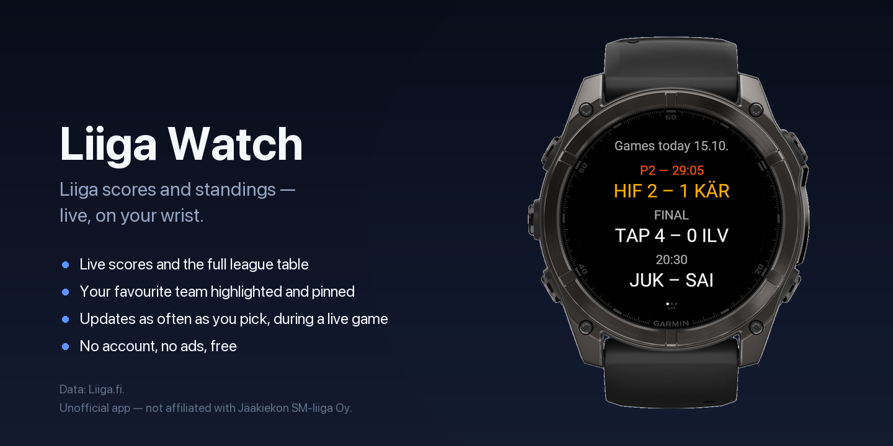

# Liiga Watch

A Garmin Connect IQ watch app for live Liiga (SM-liiga) hockey scores and the
full league table, on your wrist.



Independent project, not affiliated with or endorsed by Liiga or Garmin.
Scores and standings: [Liiga.fi](https://liiga.fi/).

## What it does

- **Today** — today's games at a glance: kickoff time before a game starts,
  period and game clock live, final score once it's over. Games decided by a
  shootout are marked (VL). No games today? Shows the next game day's
  fixtures instead.
- **Table** — the full league table, with every team's rank and points.
- **Favourite team** — pick one: it always sits at the top of today's list
  and stays highlighted and pinned in the table even outside the top group.
- **Update speed** — on game days, choose how often scores refresh (5, 15,
  30 or 60 seconds).
- **Glance** — check the score from the widget carousel without opening the
  app.
- Finnish, Swedish and English, following the watch's own language setting.

Scope is deliberately scores + standings only — no player stats, no goal
scorers, no other leagues.

## How it works

The watch talks to a small backend (`backend/`, FastAPI) that fetches from
liiga.fi's own open (if undocumented) `/api/v2` endpoints, caches briefly,
and re-serves a simplified JSON shape to the app. No account, no sign-in —
the backend only proxies public data.

```
watch (WiFi/phone Bluetooth) → backend (HTTPS) → liiga.fi
```

The hosted backend is live at
[liigawatch.tallimedia.com](https://liigawatch.tallimedia.com/), which also
serves a plain web version of the scores/table for anyone without the watch
app.

## Repo layout

- **`backend/`** — FastAPI proxy: `/v1/games`, `/v1/standings`, a public
  scores page, `/privacy`, `/terms`. See `backend/app/README.md`.
- **`watch/`** — the Connect IQ app itself (Monkey C). `watch/store-listing.md`
  has the Store copy; `watch/store/` the store art.
- **`Screenshots/`** — bezel-framed device captures used in the Store
  listing.

## Status

Live on the Connect IQ Store since 2026-10-24 (v1.2.0). Public listing:
<https://apps.garmin.com/en-US/apps/2c581f70-1211-4a8a-a873-e6ff968f234b>.
Feedback and issues welcome on this repository.

## License

[PolyForm Noncommercial 1.0.0](LICENSE) — free to use, modify, and
redistribute for any noncommercial purpose. Not licensed for commercial use,
including running a paid or ad-supported service based on this code.
